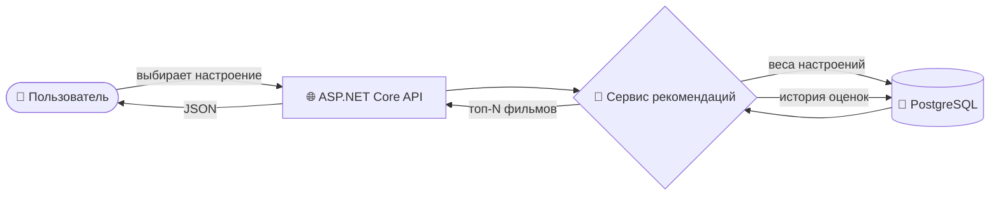
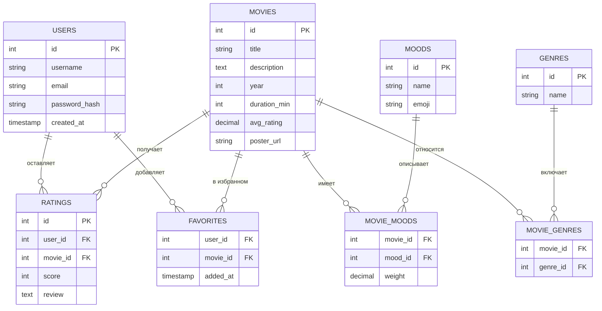

<div align="center">

# 🎬 Кинолюксия

### ✨ Фильм под твоё настроение — за пару кликов ✨

*Грустно? Весело? Хочется адреналина или уюта?*
*Скажи, как ты себя чувствуешь, — а Кинолюксия подберёт, что посмотреть.*

<br>


[✨ Возможности](#-возможности) •
[🧠 Как это работает](#-как-это-работает) •
[🚀 Быстрый старт](#-быстрый-старт) •
[🗄️ База данных](#️-база-данных) •
[📡 API](#-api) •
[🗺️ Roadmap](#️-roadmap)

</div>

---

## 🍿 Что это?

**Кинолюксия** — сервис рекомендаций фильмов, который подбирает кино не по жанрам и спискам «топ-250», а по **настроению**. Выбираешь, как себя чувствуешь, — получаешь подборку, которая подходит именно сейчас.

```
😢 Грусть  ──▶  🎬 «Душевные драмы» · «Тёплые мелодрамы» · «Истории о надежде»
🔥 Азарт   ──▶  🎬 «Боевики» · «Триллеры» · «Гонки на выживание»
🥹 Ностальгия ──▶ 🎬 «Классика 80-х» · «Хиты 90-х» · «Фильмы детства»
```

---

## ✨ Возможности

- 😊 **Подбор по настроению** — радость, грусть, тревога, вдохновение, ностальгия, скука и другие
- 🎭 **Гибкие фильтры** — жанр, год выпуска, рейтинг, длительность
- ⭐ **Оценки и отзывы** — оценивайте фильмы, и рекомендации станут точнее
- ❤️ **Избранное** — личный список понравившихся фильмов
- 🔐 **Авторизация** — регистрация и вход по JWT
- 🗃️ **Надёжное хранение** — PostgreSQL, удобное администрирование через pgAdmin
- 📖 **Swagger UI** — интерактивная документация API «из коробки»

---

## 🧠 Как это работает

Каждому фильму сопоставляются **настроения с весами** (от 0 до 1). Когда пользователь выбирает настроение, сервис ранжирует фильмы по степени совпадения и дополнительно учитывает рейтинг и личные предпочтения.



**Формула релевантности:**

```
score = mood_weight × 0.6  +  avg_rating / 10 × 0.3  +  user_affinity × 0.1
```

---

## 🛠️ Технологии

| Слой | Технология |
|------|-----------|
| **Язык** | C# 12 |
| **Платформа** | .NET 8, ASP.NET Core Web API |
| **ORM** | Entity Framework Core + Npgsql |
| **База данных** | PostgreSQL 16 |
| **Администрирование БД** | pgAdmin 4 |
| **Аутентификация** | JWT Bearer |
| **Документация** | Swagger / OpenAPI |
| **Тесты** | xUnit |

---

## 🏗️ Структура проекта

```
Kinolyuksiya/
├── 📁 src/
│   ├── 📁 Kinolyuksiya.Api/             # Контроллеры, middleware, Program.cs
│   ├── 📁 Kinolyuksiya.Application/     # Сервисы, DTO, логика рекомендаций
│   ├── 📁 Kinolyuksiya.Domain/          # Сущности (Movie, Mood, User…)
│   └── 📁 Kinolyuksiya.Infrastructure/  # EF Core, DbContext, миграции
├── 📁 tests/
│   └── 📁 Kinolyuksiya.Tests/           # Unit-тесты
├── 📄 Kinolyuksiya.sln
└── 📄 README.md
```

---

## 🚀 Быстрый старт

### Требования

- [.NET SDK 8.0+](https://dotnet.microsoft.com/download)
- [PostgreSQL 16+](https://www.postgresql.org/download/)
- [pgAdmin 4](https://www.pgadmin.org/download/)

### 1️⃣ Получите код

Нажмите зелёную кнопку **Code** в верхней части репозитория и выберите **Download ZIP**, либо склонируйте проект через Git (адрес — в той же кнопке **Code**) и перейдите в папку проекта.

### 2️⃣ Создайте базу данных через pgAdmin

1. Откройте **pgAdmin 4** и подключитесь к серверу PostgreSQL
2. Нажмите ПКМ по **Databases → Create → Database…**
3. Укажите имя базы `kinolyuksiya` и нажмите **Save**

### 3️⃣ Настройка подключения

Строка подключения по умолчанию уже настроена на локальный PostgreSQL (`postgres` / `postgres`, порт `5432`):

```json
{
  "ConnectionStrings": {
    "DefaultConnection": "Host=localhost;Port=5432;Database=kinolyuksiya;Username=postgres;Password=postgres"
  }
}
```

> 💡 Если при установке PostgreSQL вы задали другой пароль, измените его в `src/Kinolyuksiya.Api/appsettings.json`. Для продакшена храните секреты в переменных окружения.

### 4️⃣ Примените миграции

```bash
dotnet tool install --global dotnet-ef
dotnet ef database update --project src/Kinolyuksiya.Infrastructure --startup-project src/Kinolyuksiya.Api
```

### 5️⃣ Запустите

```bash
dotnet run --project src/Kinolyuksiya.Api
```

🎉 Откройте **Swagger UI**: `https://localhost:5001/swagger`

---

## 🗄️ База данных

### ER-диаграмма



### Работа через pgAdmin

- 🔍 **Просмотр данных:** `kinolyuksiya → Schemas → public → Tables → ПКМ → View/Edit Data`
- 🧪 **SQL-запросы:** `Tools → Query Tool` (`Alt + Shift + Q`)
- 💾 **Резервная копия:** ПКМ по базе → **Backup…**
- 📊 **Схема связей:** ПКМ по базе → **ERD Tool**

Пример запроса — топ-5 фильмов для настроения «Радость»:

```sql
SELECT m.title, m.year, m.avg_rating, mm.weight
FROM movies m
JOIN movie_moods mm ON mm.movie_id = m.id
JOIN moods md       ON md.id = mm.mood_id
WHERE md.name = 'Радость'
ORDER BY mm.weight DESC, m.avg_rating DESC
LIMIT 5;
```

---

## 😶‍🌫️ Настроения

| Эмодзи | Настроение | Что рекомендуем |
|:---:|---|---|
| 😄 | Радость | Комедии, мюзиклы, семейное кино |
| 😢 | Грусть | Драмы, мелодрамы, «душевное» кино |
| 😰 | Тревога | Уютные фильмы, добрые истории |
| 🔥 | Азарт | Боевики, триллеры, гонки |
| 🌌 | Задумчивость | Фантастика, арт-хаус, философские драмы |
| 🥹 | Ностальгия | Классика, фильмы 80-х и 90-х |
| 🚀 | Вдохновение | Биографии, спорт, истории успеха |
| 🥱 | Скука | Что-то неожиданное и динамичное |

---

## 📡 API

| Метод | Эндпоинт | Описание |
|:---:|---|---|
| `GET` | `/api/moods` | Список всех настроений |
| `GET` | `/api/recommendations?mood=joy&limit=10` | Рекомендации по настроению |
| `GET` | `/api/movies/{id}` | Информация о фильме |
| `POST` | `/api/movies/{id}/rate` | Оценить фильм 🔒 |
| `GET` | `/api/favorites` | Избранное пользователя 🔒 |
| `POST` | `/api/favorites/{movieId}` | Добавить в избранное 🔒 |
| `POST` | `/api/auth/register` | Регистрация |
| `POST` | `/api/auth/login` | Вход, получение JWT |

🔒 — требуется заголовок `Authorization: Bearer <token>`

**Пример ответа:**

```json
GET /api/recommendations?mood=joy&limit=2

[
  {
    "id": 42,
    "title": "Паддингтон 2",
    "year": 2017,
    "avgRating": 8.1,
    "matchScore": 0.94,
    "genres": ["Комедия", "Семейный"]
  },
  {
    "id": 17,
    "title": "Амели",
    "year": 2001,
    "avgRating": 8.3,
    "matchScore": 0.91,
    "genres": ["Комедия", "Романтика"]
  }
]
```

---

## 🧪 Тесты

```bash
dotnet test
```

---

## 🗺️ Roadmap

- [x] Базовая структура проекта
- [x] Подбор фильмов по настроению
- [x] Авторизация (JWT)
- [x] Избранное и оценки
- [ ] 🎨 Веб-интерфейс
- [ ] 🤖 Персонализация на основе истории оценок
- [ ] 🎞️ Интеграция с TMDB API (постеры, трейлеры)
- [ ] 🐳 Docker Compose (API + PostgreSQL + pgAdmin)
- [ ] 🌍 Мультиязычность
- [ ] 📱 Мобильная версия

---

## 🤝 Участие в проекте

Будем рады вашим идеям и pull request'ам!

1. Сделайте **Fork** репозитория
2. Создайте ветку: `git checkout -b feature/amazing-feature`
3. Закоммитьте изменения: `git commit -m "Add amazing feature"`
4. Отправьте ветку: `git push origin feature/amazing-feature`
5. Откройте **Pull Request**

---

## 📄 Лицензия

Проект распространяется по лицензии **MIT**.

---

<div align="center">

### 🍿 Приятного просмотра с Кинолюксией!

Если проект понравился — поставьте ⭐ репозиторию

</div>
